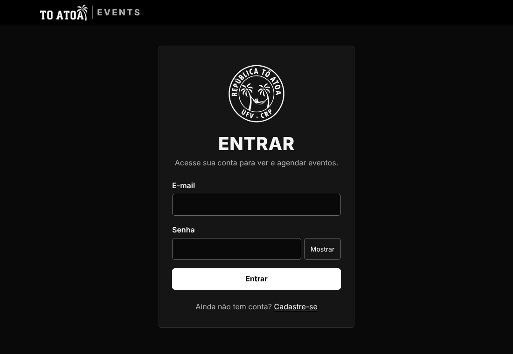
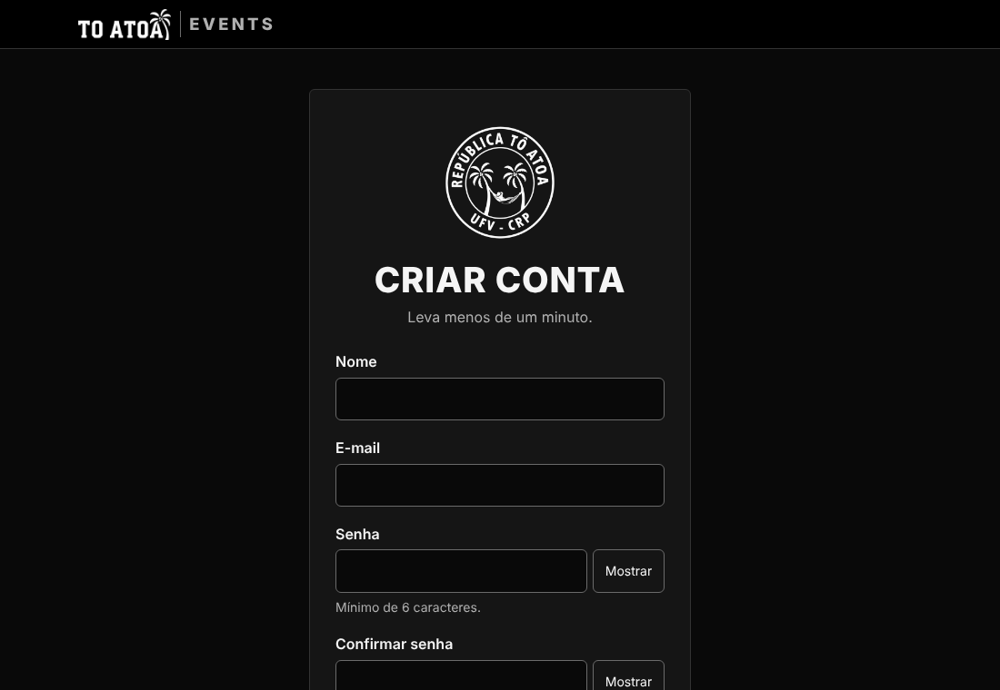
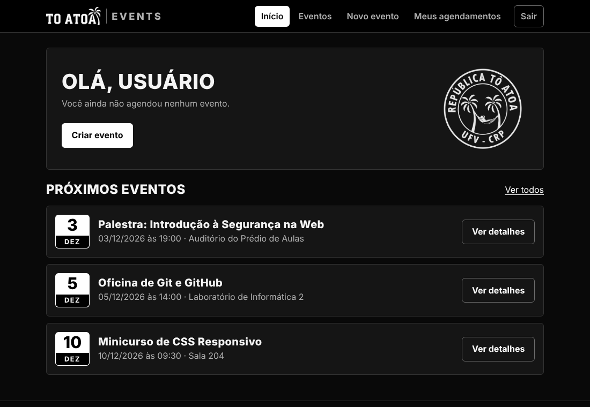
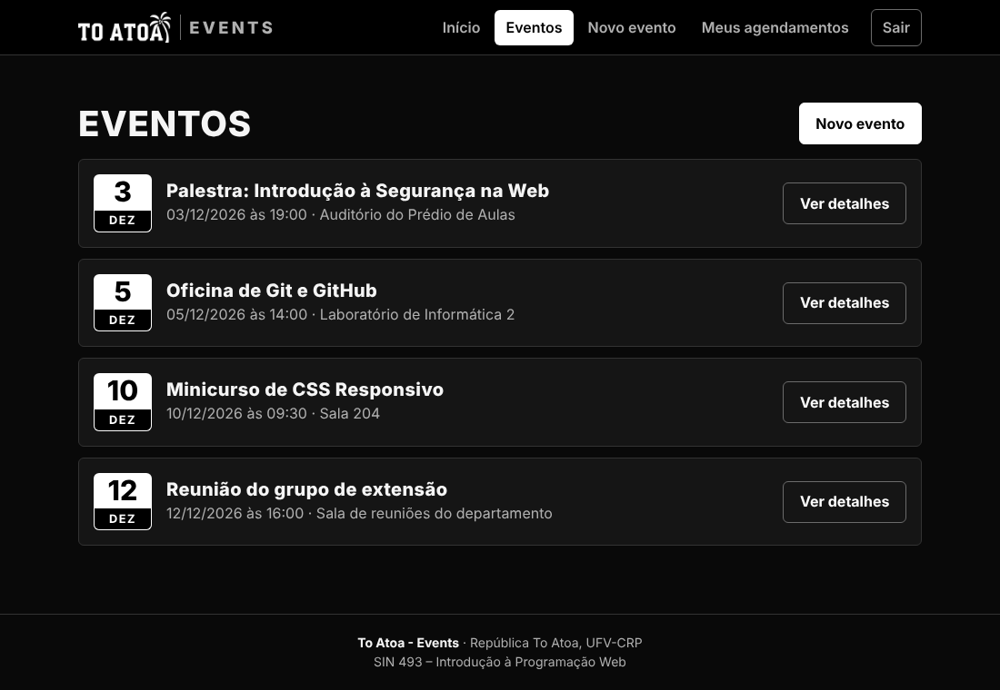
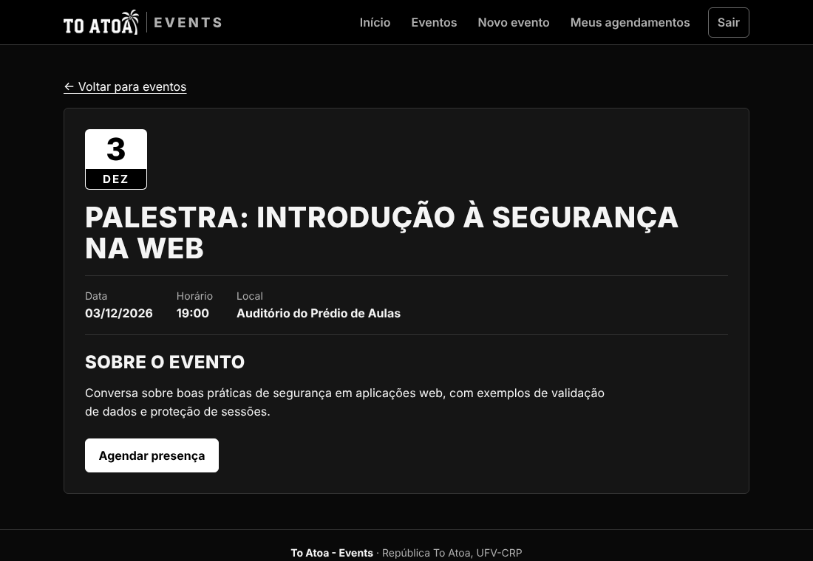
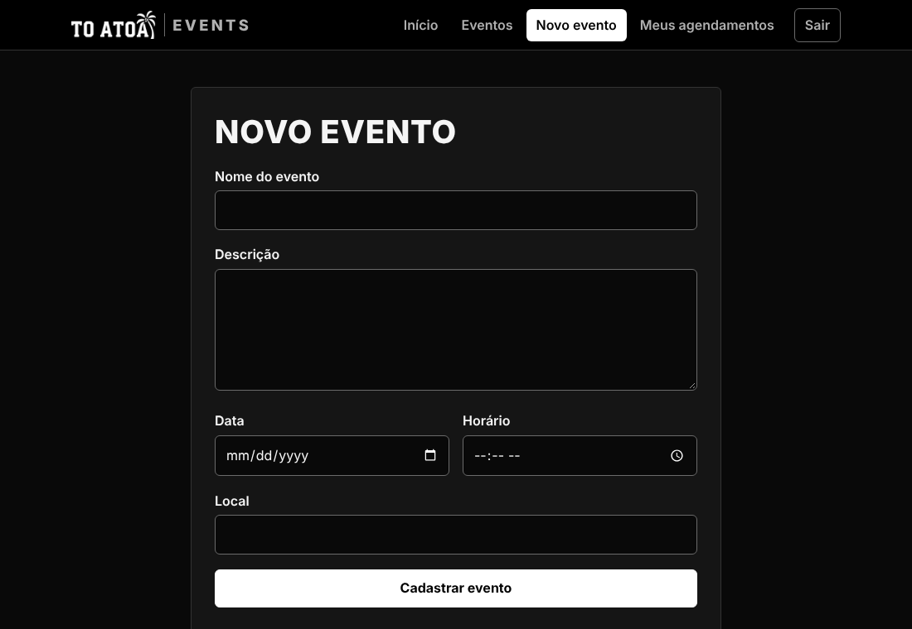
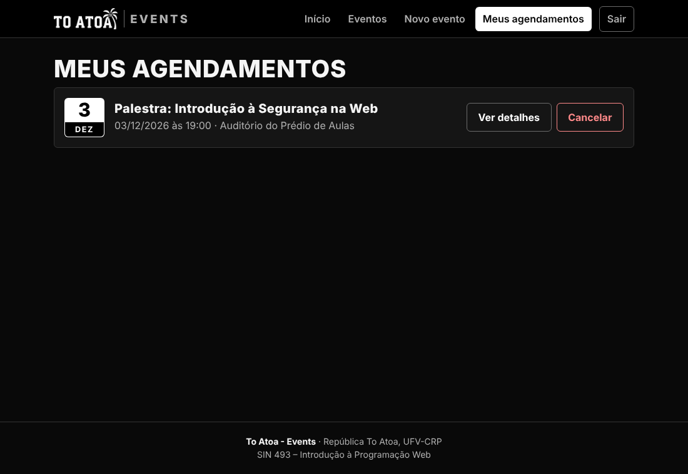

<p align="center"></p>

# To Atoa - Events – Sistema de Agendamento de Eventos

Sistema desenvolvido com a identidade visual da **República To Atoa (UFV-CRP)**.

Trabalho avaliativo de **SIN 493 – Tópicos Especiais III: Introdução à Programação Web**
(UFV – Campus Rio Paranaíba, prof. Bernardo Teixeira de Miranda).

## Objetivo

Sistema web simples em que uma pessoa cria uma conta, entra no sistema, consulta eventos,
vê os detalhes, agenda presença e cancela o agendamento quando quiser.

## Integrantes

9946 - Gabriel de Sousa Siqueira 
9866 - Gabriel Duarte Mendes 
9862 - Leonardo Padovani Manzato
9872 - Diego Antonio de Melo Medeiros 

## Tecnologias utilizadas

- HTML5
- CSS3 (arquivo único, `css/estilo.css`), com tema preto e branco da república
- JavaScript puro (`js/scripts.js`)
- PHP puro (sessões, `password_hash`, leitura e gravação de arquivos)
- Arquivos JSON como armazenamento (`dados/`)
- Git e GitHub

Nenhum framework, biblioteca ou banco de dados foi utilizado.

## Funcionalidades implementadas

1. Cadastro de usuário (JavaScript e PHP validam; e-mail duplicado é bloqueado)
2. Login com e-mail e senha
3. Usuário mantido conectado por sessão PHP
4. Logout pela opção **Sair**
5. Cadastro de evento (qualquer usuário conectado)
6. Listagem de eventos, ordenados por data e horário
7. Detalhes do evento
8. Agendamento em um evento
9. Tela **Meus agendamentos**, só com os eventos do usuário conectado
10. Cancelamento de agendamento, com confirmação em JavaScript
11. Bloqueio de agendamento repetido no mesmo evento
12. Mensagens de sucesso e erro após as operações

Extras: páginas internas protegidas por login, token CSRF nos formulários, impedimento de
agendar eventos já encerrados e menu adaptado para telas pequenas.

### Validações em JavaScript

Campos obrigatórios, formato do e-mail, senhas iguais, tamanho mínimo da senha, data não
passada, confirmação antes de cancelar e botão **Mostrar/Ocultar** senha. O PHP repete todas as
verificações no servidor.

## Como executar

Requisito: **PHP 7.4 ou superior** instalado (ou XAMPP/WAMP/Laragon).

### Opção 1 – servidor embutido do PHP

```bash
git clone <link-do-repositorio>
cd sistema-eventos
php -S localhost:8000
```

Abra <http://localhost:8000> no navegador.

### Opção 2 – XAMPP

1. Copie a pasta `sistema-eventos` para `C:\xampp\htdocs\`.
2. Inicie o Apache no painel do XAMPP.
3. Acesse <http://localhost/sistema-eventos>.

> A pasta `dados/` precisa de permissão de escrita, pois o PHP grava nela.

## Usuário de teste

| E-mail              | Senha    |
|---------------------|----------|
| teste@exemplo.com   | senha123 |

Também é possível criar uma conta nova pela tela de cadastro. Quatro eventos de exemplo já
estão cadastrados em `dados/eventos.json`.

## Estrutura do projeto

```
sistema-eventos/
|-- index.php               redireciona para login ou início
|-- login.php               tela de login
|-- cadastro.php            cadastro de usuário
|-- inicio.php              página inicial
|-- eventos.php             lista de eventos
|-- detalhes.php            detalhes do evento
|-- criar-evento.php        cadastro de evento
|-- meus-agendamentos.php   agendamentos do usuário
|-- agendar.php             processa o agendamento
|-- cancelar.php            processa o cancelamento
|-- logout.php              encerra a sessão
|-- includes/               funções, cabeçalho e rodapé
|-- css/estilo.css
|-- js/scripts.js
|-- img/                    logotipos da República To Atoa
|-- dados/                  usuarios.json, eventos.json, agendamentos.json
`-- docs/                   capturas de tela
```

## Telas do sistema

| Tela | Imagem |
|------|--------|
| Login |  |
| Cadastro |  |
| Página inicial |  |
| Eventos |  |
| Detalhes do evento |  |
| Novo evento |  |
| Meus agendamentos |  |
